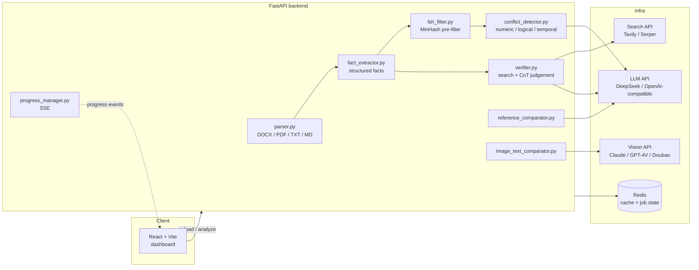
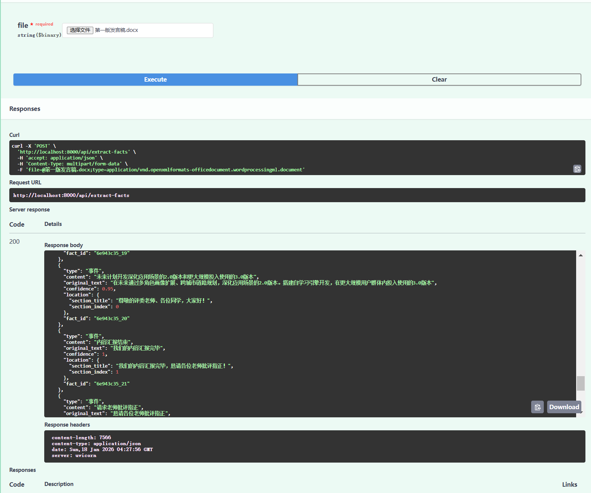
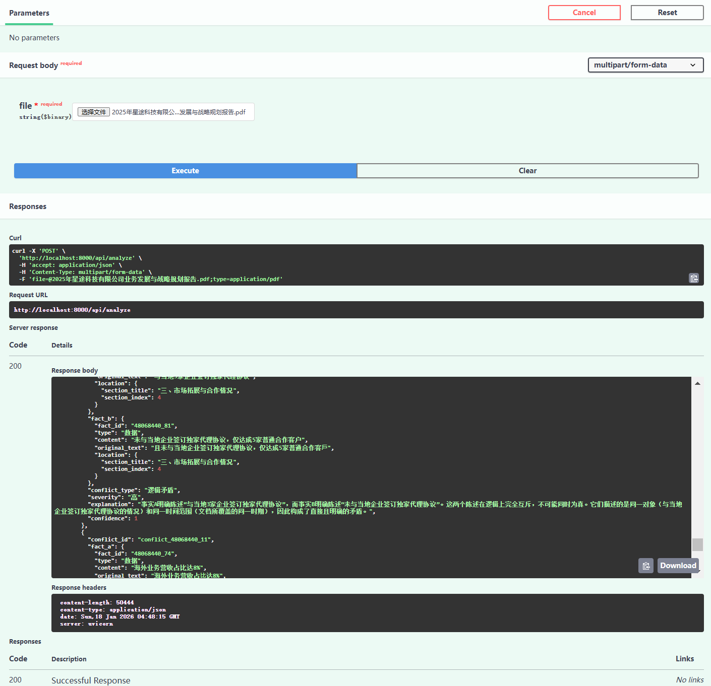
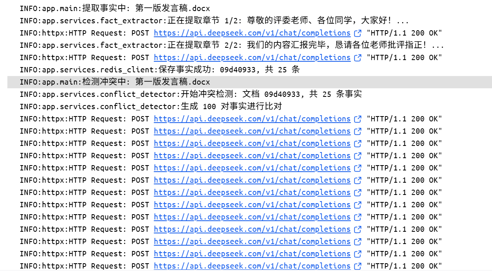
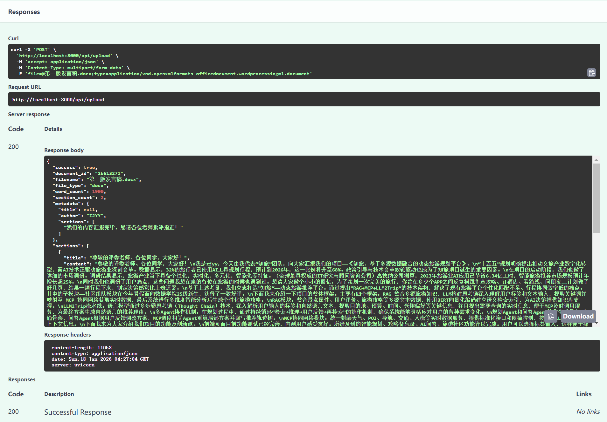

<div align="center">


# FactGuardian

**Audit long documents for factual consistency — extract facts, catch contradictions, verify against the web, and check figures against text.**

[](LICENSE)
[](backend/requirements.txt)
[](frontend/package.json)
[](docker-compose.yml)
[](CONTRIBUTING.md)

[English](README.md) · [简体中文](README.zh-CN.md)

</div>

---

## Why

Long documents written by several people drift. Chapter 3 says revenue grew **8%**, the appendix says **12%**. A diagram labels a step the prose never mentions. A "final" number survives three revisions while the table under it does not.

Reviewers catch this by hand, slowly, and only sometimes. FactGuardian turns that review into a repeatable pipeline: **parse → extract facts → detect internal conflicts → verify against external sources → compare against reference documents and figures**, with a React dashboard that highlights exactly where the problem is.

It is built for theses, feasibility reports, technical specs, and any multi-author document where a contradiction costs credibility.

## What it catches

A real snippet from `POST /api/analyze` — two statements in the same section, flagged as a logical contradiction:

```json
{
  "conflict_type": "逻辑矛盾",
  "severity": "高",
  "confidence": 1,
  "explanation": "事实A明确陈述\"与当地企业签订独家代理协议\"，而事实B明确陈述\"未与当地企业签订独家代理协议\"。这两个陈述在逻辑上完全互斥…",
  "fact_a": { "content": "与当地企业签订独家代理协议", "location": { "section_title": "三、市场拓展与合作情况" } },
  "fact_b": { "content": "未与当地企业签订独家代理协议", "location": { "section_title": "三、市场拓展与合作情况" } }
}
```

Every conflict carries the **two source facts, their document locations, a severity, a confidence, and a human-readable reason** — so the fix is obvious.

## Features

| Capability | What you get |
| :-- | :-- |
| **Fact extraction** | Structured facts (numbers, dates, people, claims, events) with type, confidence, and document location. DOCX / PDF / TXT / Markdown. |
| **Internal conflict detection** | Numeric drift (≥10% ratio or ≥20% relative gap), logical contradictions (assert vs. negate), temporal clashes, and repeated passages (3× or more). |
| **Source verification** | Optional web search (Tavily / Serper) + LLM chain-of-thought judgement, with High / Medium / Low confidence and a suggested correction. |
| **Reference comparison** | Upload reference documents; get paragraph-level similarity, similarity type (quote / paraphrase / idea / unrelated), and citation suggestions. |
| **Image ↔ text check** | Compare diagrams or figures against the prose with a vision model (Claude / GPT-4V / Doubao): what the diagram claims vs. what the text claims. |
| **Speed** | MinHash/LSH pre-filter cuts pairwise comparisons by 50–600×; batched parallel LLM calls; Redis cache with in-memory fallback. |
| **Live progress** | Server-Sent Events stream per-document progress to the UI, so long documents never feel stuck. |

## Architecture



## Quickstart

**Requirements:** Docker Desktop 24+, Docker Compose 1.29+, 8 GB RAM (16 GB recommended).

```bash
git clone https://github.com/LuYuan-Zjyy/factguardian.git
cd factguardian
cp .env.example .env        # then fill in DEEPSEEK_API_KEY
docker compose up -d --build
```

| Service | URL |
| :-- | :-- |
| Dashboard | http://localhost:3000 |
| API docs (Swagger) | http://localhost:8000/docs |
| Health check | http://localhost:8000/health |

Windows users can use the bundled scripts: `.\start-docker.ps1`, `.\stop-docker.ps1`, `.\restart-docker.ps1`.

> Only `DEEPSEEK_API_KEY` is required. Vision and search keys are optional — the corresponding features degrade gracefully and mark results as unavailable instead of failing.

## API at a glance

```bash
# 1. upload a document
curl -X POST http://localhost:8000/api/upload -F "file=@report.docx"

# 2. extract facts, then detect conflicts
curl -X POST http://localhost:8000/api/documents/<id>/extract-facts
curl -X POST http://localhost:8000/api/detect-conflicts/<id>

# 3. verify facts against the web (needs a search key)
curl -X POST http://localhost:8000/api/documents/<id>/verify-facts

# 4. compare against reference documents
curl -X POST http://localhost:8000/api/compare-references \
  -H "Content-Type: application/json" \
  -d '{"main_doc_id":"main123","ref_doc_ids":["ref1"],"similarity_threshold":0.3}'

# 5. check a figure against the prose
curl -X POST http://localhost:8000/api/compare-image-text \
  -F "file=@architecture.png" -F "document_id=<id>"
```

Progress for any job is available as SSE at `GET /api/progress/<id>`.

## Performance

From [`EXPERIMENT_REPORT.md`](EXPERIMENT_REPORT.md), measured on the bundled sample document:

| Facts | Naive pairs | After LSH pre-filter | Reduction |
| ---: | ---: | ---: | ---: |
| 100 | 4,950 | ~50–100 | 50–100× |
| 500 | 124,750 | ~200–300 | 400–600× |

End-to-end analysis of a ~100-fact document drops from **5–10 minutes** (naive pairwise LLM calls) to **15–30 seconds** on the same hardware, because only candidate pairs reach the model.

## Project layout

```
backend/app/          FastAPI app + services (parser, extractor, detector, verifier, comparators)
frontend/src/         React dashboard (upload, document viewer, conflict list, comparisons)
image/                Screenshots used in this README
docker-compose.yml    backend + frontend + redis
```

## Screenshots

| Fact extraction | Conflict detected |
| :--: | :--: |
|  |  |

| Reference comparison | Upload |
| :--: | :--: |
|  |  |

## Roadmap

- [ ] **Streaming extraction** for very large documents (chunk-level progress instead of document-level).
- [ ] **Export to Markdown/PDF report** with all conflicts and suggested fixes.
- [ ] **Provider abstraction** so vision/search backends plug in without code changes.
- [ ] **Evaluation harness**: a small labelled set of contradictory documents with precision/recall.
- [ ] **English prompts** alongside the current Chinese prompt templates.

See [open issues](https://github.com/LuYuan-Zjyy/factguardian/issues) — the ones labelled `good first issue` are scoped to be picked up in an afternoon.

## Contributing

Contributions are very welcome — bug reports, prompt improvements, new providers, UI polish. Please read [CONTRIBUTING.md](CONTRIBUTING.md) first, and open an issue before starting anything large.

## License

[MIT](LICENSE) © 2026 LuYuan-Zjyy
